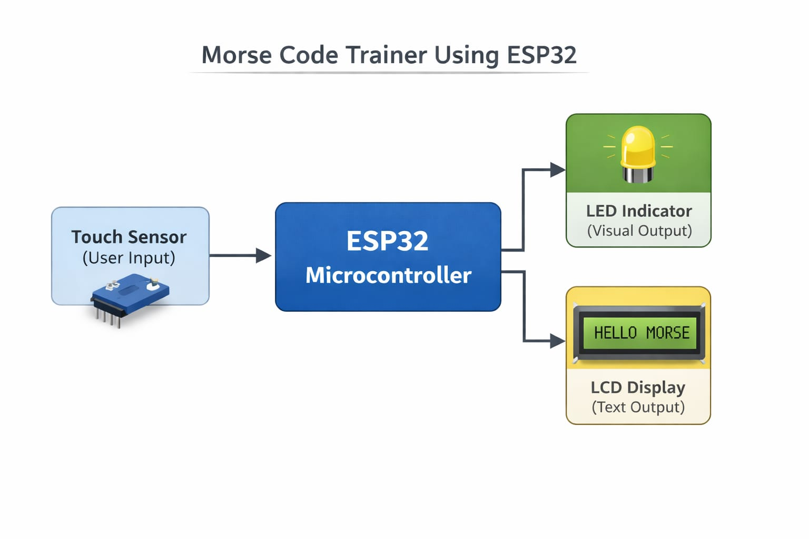

# Morse Code Trainer 🔤

An ESP32-based hardware signal processing system that decodes human touch inputs into Morse code and displays the decoded text on an LCD screen.

## About

This project implements a real-time Morse code decoder using time-domain signal analysis. The system treats user touch input as a continuous-time binary signal and uses temporal thresholds to distinguish between dots (·) and dashes (−), then maps the decoded sequence to alphanumeric characters via a look-up table.

**Course:** Signals and Systems (S4)  
**Institution:** Model Engineering College, Thrikkakara (APJ Abdul Kalam Kerala Technological University)  
**Academic Year:** 2025–26

## Team

- **Francisca Thankachan** (Roll No: 28)
- **Jacob Saji** (Roll No: 30)
- **Jishnu Prashanth** (Roll No: 32)

## System Overview

### Components

| Component | Description |
|-----------|-------------|
| **ESP32-WROOM-32** | Dual-core microcontroller with WiFi + Bluetooth |
| **TTP223** | Capacitive touch sensor (input) |
| **LCD1602 + I2C** | 16×2 LCD display (text output) |
| **RGB LED (5mm)** | Visual feedback — Green for dot, Blue for dash |

### How It Works

1. **Touch Detection** — The ESP32 monitors the capacitive touch sensor and starts timing when a touch is detected.
2. **Debounce Filtering** — Touches shorter than 50ms are discarded as noise/accidental contact.
3. **Dot vs Dash Classification** — Touches of 50–250ms → **Dot** (Green LED) · Touches >600ms → **Dash** (Blue LED).
4. **Character Decoding** — After 1 second of inactivity, the dot/dash sequence is matched against a Morse code look-up table and the decoded letter is displayed on the LCD.

## Project Report

The full project report (LaTeX source + compiled PDF) is included in this repository:

- [`Report_SS.tex`](Report_SS.tex) — LaTeX source
- [`Report_SS.pdf`](Report_SS.pdf) — Compiled PDF report

## Future Scope

- **Audio Feedback** — Piezoelectric buzzer with PWM for auditory Morse code feedback
- **Adaptive Thresholding** — ML-based dynamic threshold adjustment based on user typing speed
- **Wireless Transmission** — Real-time decoded text via ESP32 WiFi/Bluetooth to a smartphone app

## License

This project was developed as part of academic coursework at Model Engineering College.
